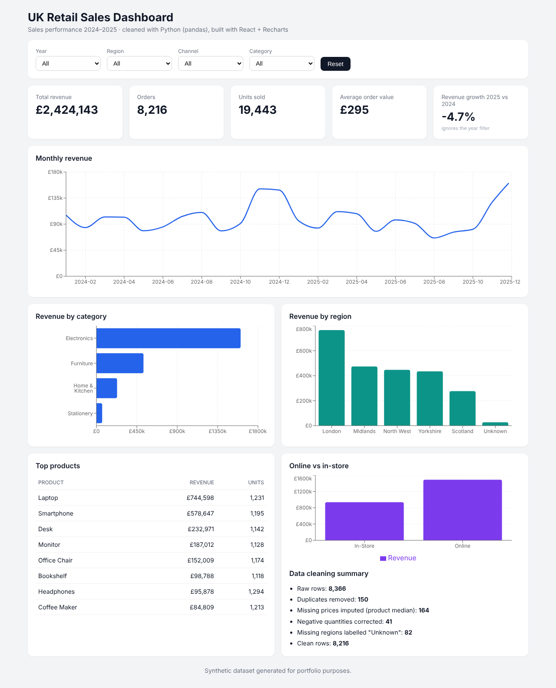

# UK Retail Sales Dashboard

An end-to-end data analytics project: messy raw sales data is cleaned and aggregated with **Python (pandas)**, then explored through an interactive **React + Recharts** dashboard.



## What it does

- **Data cleaning pipeline (Python / pandas)**: removes duplicate orders, standardises inconsistent text, parses mixed date formats (ISO and UK `DD/MM/YYYY`), corrects negative quantities, imputes missing prices using the product median, and flags missing regions.
- **Interactive dashboard (React)**: filter by year, region, channel and category. It shows KPIs (revenue, orders, units, average order value, year-on-year growth), the monthly revenue trend, revenue by category and region, top products, and online vs in-store sales.
- **Data quality report**: the dashboard shows exactly what the cleaning step fixed.

## Key findings (full dataset)

- Total revenue of about **£2.4m** across **8,216 orders**, with an average order value of about **£295**.
- **Electronics** generates the large majority of revenue, led by laptops and smartphones.
- **London** is the strongest region; **online** outsells in-store.
- There are clear **seasonal peaks in November–December** each year.
- The cleaning step removed **150 duplicates** and repaired **287 invalid or missing values**.

## Tech stack

| Layer | Tools |
|---|---|
| Data cleaning & analysis | Python, pandas, NumPy |
| Front end | React, Vite, Recharts, CSS |
| Data format | CSV → aggregated JSON |

## Project structure

```
retail-sales-dashboard/
├── data/
│   ├── generate_raw_data.py      # creates the messy raw dataset
│   ├── raw/sales_raw.csv
│   └── clean/sales_clean.csv
├── analysis/
│   └── clean_and_aggregate.py    # cleaning pipeline + JSON export
├── web/                          # React dashboard (Vite)
│   └── src/App.jsx
└── docs/dashboard.png
```

## How to run

```bash
# 1. Data pipeline
pip install -r requirements.txt
python data/generate_raw_data.py
python analysis/clean_and_aggregate.py

# 2. Dashboard
cd web
npm install
npm run dev        # open http://localhost:5173
```

## About the data

The dataset is **synthetic**. It was generated by `data/generate_raw_data.py` to mimic two years of UK retail sales, with realistic data quality problems added on purpose so the cleaning pipeline has real work to do.

## Possible next steps

- Swap in a real public dataset (e.g. from Kaggle or the ONS)
- Add a SQL layer (SQLite) between cleaning and the dashboard
- Add a simple sales forecast (e.g. linear regression or Prophet)
- Deploy the dashboard on Vercel or GitHub Pages
